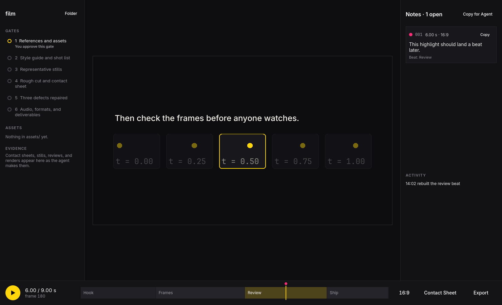

# omotion



omotion previews, reviews, and renders motion scenes for Omarchy. A scene is
one QML file in which everything on screen is computed from the time `t`, so
any frame can be asked for on its own, in any order. That makes revisions
local: a title that enters too early is one number, a shape that overshoots
is one spring.

It's built for the way agents make video. You (or your coding agent) write
the scene, and omotion:

- **previews it live**, reloading whenever the file is saved and staying on
  the moment you were looking at;
- **shows a contact sheet**, every beat at once, so you look at the frames
  before anyone watches the film;
- **checks it**: no wall clocks, no randomness that changes, no state carried
  between frames, no text outside the frame in any format;
- **renders each format from the source**: 16:9, 9:16, 1:1, and 4:5 are composed
  by the scene, not cropped from one another, and encoded with ffmpeg.

## Making a film

```sh
omotion new ~/Videos/launch
```

That creates the film's folder, its studio:

```
launch/
  brief.md           what the film says, and the facts about the product
  style-guide.md     palette, type, and motion rules
  shotlist.md        beats, states, and every word on screen
  assets/            the real logo, screens, and sound, listed in assets.md
  scene.qml          the film, a starter until it's built
  reviews/           contact sheets and defect notes
  renders/           one video per format
  gates.md           the six gates, and who approved each
  notes.md           your notes, pinned to moments of the film
  activity.md        the agent's steps
  AGENTS.md          points agents to the skill
  .claude/skills/omotion/SKILL.md
```

Open your coding agent in that folder and ask for the film you want. The
skill in it leads the agent through the six gates of [Motion
Engineering](https://x.com/0xwhrrari/status/2105643919119696297), and the
agent stops for your approval at three of them: the brief and assets, the
style guide and shot list, and the finished film. Everything it decides goes
into the folder's files, so a later session picks up from `gates.md`.

The skill lives in the film's folder, not in your home folder, so it always
matches the omotion that made the film. When omotion is updated, `omotion
check` says so, and `omotion skill install` in the folder updates it.

## Directing from the studio

`omotion open ~/Videos/launch/scene.qml` opens the film in the studio window,
which watches the agent work:

- **Gates** from `gates.md`: which are passed, which is current, and which is
  waiting for your approval. Each opens the files that are its evidence.
- **Assets** in `assets/`, with anything `assets.md` lists as missing.
- **Evidence**: contact sheets, stills, reviews, and renders, newest first.
- **Activity**: the agent's steps, from `activity.md`.
- **The film**, reloading every time the agent saves.

To ask for a change, pause and **click the film where it's wrong**. omotion
pins your note to that moment in `notes.md`, with the beat, the text under the
pointer, and a frame with the spot ringed. Tell the agent "check my notes", or
press **Copy for Agent** and paste. The agent fixes each note with evidence and
ticks it, or replies, and you see it in the window. A note never passes a gate;
only you do.

## A scene

```qml
import QtQuick
import Omotion

Rectangle {
    property real t: 0
    property real duration: 6
    property var formats: ["16:9", "9:16"]
    property var beats: [{ at: 0, name: "Hook" }, { at: 3, name: "Proof" }]

    color: "#0d0d10"

    Text {
        id: title
        readonly property real arrive: Motion.spring(parent.t, 0.2)
        anchors.centerIn: parent
        text: "Hello"
        color: "white"
        font.pixelSize: 140
        opacity: Motion.clamp(arrive, 0, 1)
        transform: Translate { y: (1 - title.arrive) * 60 }
    }
}
```

`omotion help format` prints the whole format and the `Motion` helpers, and
`omotion new scene.qml` writes a single starter scene, outside any studio.

## Shortcuts

| Key | Action |
| --- | --- |
| Space | Play or pause |
| ← → | Step one frame |
| Shift ← → | Jump one second |
| [ ] | Previous or next beat |
| Home End | Start or end |
| F | Next format |
| C | Contact sheet |
| E | Export this format |
| Shift E | Export every format |
| O | Open a scene |
| N | New film |
| R | Reload the scene |
| P | Show or hide the studio panels |
| Click the film | Pin a note to that moment |
| ? | Show shortcuts |
| Q | Quit |

## Commands

None of these need a display. Each takes `--json`, exits 0 or 1, and writes
errors to stderr.

```sh
omotion new film                             # start a film's studio
omotion status film                          # the gate it's at, and what each gate lacks
omotion check film/scene.qml                 # every problem, in every format
omotion sheet film/scene.qml --format all    # contact sheets as PNG
omotion review film/scene.qml                # reviews/NNN.md: measures, scores, defects
omotion frame film/scene.qml --at 3.5        # one frame as PNG
omotion render film/scene.qml                # renders/scene-16x9.mp4, scene-9x16.mp4
omotion beats film/assets/track.wav          # the track's tempo and beats, to cut to
omotion open film/scene.qml                  # the window
omotion skill install                        # update the film's agent skill (run in its folder)
```

## Building

omotion is C++ and Qt Quick, built with qmake6 and make. Everything it needs
ships with Omarchy.

```sh
bin/build      # build/omotion
bin/test       # every test, offscreen (see below)
bin/screens    # the window's screenshot set, in build/screens
bin/install    # makepkg -fsi, so omotion shows up in the app launcher
```

`bin/test` builds the app and runs two suites:

- `tests/omotion_tests.cpp`: scenes, `check`, rendering, the studio's files
  (gates, notes, assets, activity), the skill's stamp, the theme, and the
  translations.
- `tests/app_tests.cpp`: the real window offscreen, asserted on what's on
  screen (three columns when wide, tabs in a tiled half-screen, pinning a
  note, the agent's answer in view, right-to-left), and the built `omotion`
  run as a command, asserted on exactly which files it writes.

`bin/test unit` or `bin/test app` runs one suite, and `bin/test NAME...` runs
those tests in whichever suite has them. Every bug found by looking or by
review has a test that fails when the bug returns. `bin/screens` covers what assertions can't: look at the screenshots
after changing the window.

## License

MIT. See [LICENSE](LICENSE).
